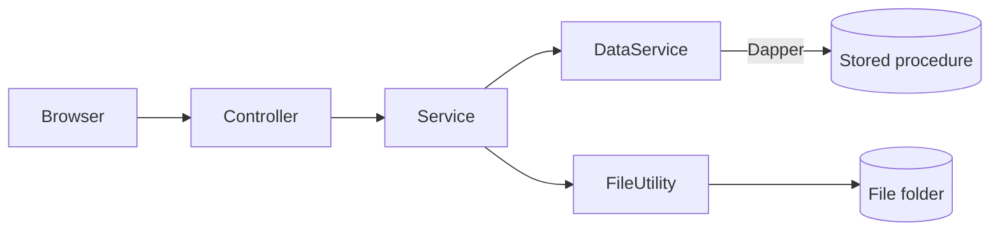
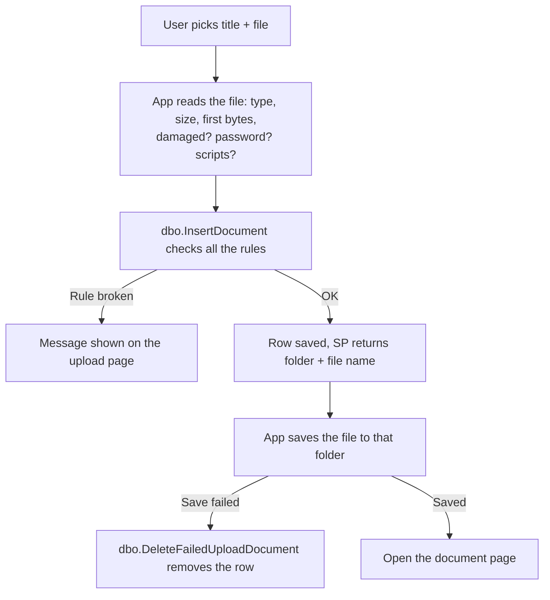
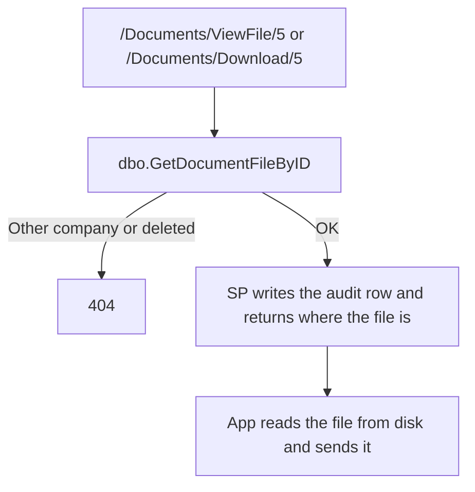

# Document Management System

A small ASP.NET Core MVC app to upload documents, find them, add notes on them and delete them. Each company sees only its own documents.

What you can do:

- Upload a document (title + file)
- See the list of documents, search by title, go page by page
- Open a document and pin notes on it
- Download or delete a document (delete is a soft delete)
- See an audit log of everything that happened

Tech: .NET 9 MVC, SQL Server, Dapper, Serilog, jQuery/Bootstrap.

The main idea: **all business rules are in stored procedures.** The C# code just passes data to the SPs, saves files and shows the result.

---

## How it works

### The big picture



- **Controller**: handles the page or AJAX request.
- **Service**: does the work for the current company. Talks to the database and the file folder.
- **DataService**: one method per stored procedure.
- **Stored procedure**: checks the rules and saves the data.

### Uploading a file



### Viewing or downloading a file

The browser never gets the file path. It only knows the document ID.



A `.docx` file is turned into a simple HTML page first, because browsers can't show Word files.

### Adding a note


---

## Getting started

You need: **.NET 9 SDK**, **SQL Server** (LocalDB is fine) and **sqlcmd** (or SSMS).

**1. Create the database**

**2. Check the connection string** in `src/DocumentManagement.Web/appsettings.json`. It points to LocalDB by default:

```json
"ConnectionStrings": {
  "DocumentManagement": "Server=Zeeshan-MC;Database=DocumentManagement;Trusted_Connection=True;TrustServerCertificate=True"
}
```

**3. Run the app**

```bash
cd src/DocumentManagement.Web
dotnet run
```

Open http://localhost:5164

## Settings

Settings live in one row of the `dbo.Parameters` table, so you can change them without a new deployment. The app picks up a change within 60 seconds.

| Column | Default | What it does |
|---|---|---|
| `SystemName` | Document Management | Title in the top bar |
| `FileBasePath` | `App_Data/Documents` | Folder where files are saved |
| `MaxUploadSizeBytes` | 25 MB | Biggest upload allowed |
| `DefaultPageSize` | 10 | Documents per page |
| `MaxPageSize` | 100 | Biggest page size allowed |
| `MaxTitleLength` | 200 | Longest title |
| `MaxNoteLength` | 1000 | Longest note |
| `DefaultCompanyID` | first company | Company shown before you pick one |

```sql
UPDATE dbo.Parameters SET SystemName = N'My Documents', DefaultPageSize = 20;
```

If you change `FileBasePath`, copy the old files to the new folder too.

If the database is down, the app keeps running and shows a friendly error page.

---

## Which files can be uploaded

The list is in the `dbo.AllowedFileType` table, and the upload page shows it.

| Type | Max size | Also checked |
|---|---|---|
| `.pdf` | 20 MB | Not damaged, no password, no JavaScript |
| `.docx`, `.xlsx` | 20 MB | Not damaged, no password, no macros |
| `.png`, `.jpg`, `.jpeg` | 10 MB | Not cut off |
| `.txt` | 5 MB | Really text, not a renamed binary file |

For every file the app also checks that the extension, the MIME type and the first bytes of the file match. A renamed `.exe` is refused.

---

## Security

- **No file path in the browser.** Pages and JSON only carry the document ID. The SP gives the path to the server only.
- **Files are outside `wwwroot`**, saved as `{CompanyID}/{year}/{month}/{guid}.ext`. There is no direct URL to a file.
- **Company check in every SP.** Another company's document gives 404.
- **SQL injection:** only stored procedures with typed parameters, no SQL built from strings.
- **CSRF:** antiforgery token on every form and AJAX call.
- **XSS:** Razor encodes output, notes are shown with `textContent`, image/text/Word previews run in a sandbox.

---

## Database

### Tables

`Company`, `Document`, `DocumentFile`, `DocumentNote`, `AllowedFileType`, `Parameters`, `AuditLog`, `ErrorLog`

### Stored procedures

| Procedure | What it does |
|---|---|
| `GetParameters` | Reads the settings row |
| `GetCompanyList` | Companies for the dropdown |
| `GetAllowedFileTypeList` | File types for the upload page |
| `InsertDocument` | Checks and saves a new upload |
| `DeleteFailedUploadDocument` | Removes the row if the file could not be saved |
| `GetDocumentList` | One page of documents, with search |
| `GetDocumentByID` | One document |
| `GetDocumentFileByID` | Where the file is (server only) + audit row |
| `DeleteDocumentByID` | Soft delete |
| `InsertDocumentNote` | Adds a note |
| `GetDocumentNotesByDocumentID` | Notes of a document |
| `GetAuditLogList` | One page of the audit log |
| `InsertAuditLog` | Writes an audit row (called by the SPs above) |
| `InsertErrorLog` | Writes a system error to `ErrorLog` |

Paging is done inside the SPs with `OFFSET / FETCH`, using indexes on `(CompanyId, DateAdded)`.

### Errors from the SPs

| Error number | Meaning | Page shows |
|---|---|---|
| 50400 | Invalid input | The SP's message |
| 50404 | Not found | 404 |
| 50409 | Already done (e.g. deleted twice) | The SP's message |
| anything else | System error | Friendly error + error id, saved in `ErrorLog` |

Logs are written to `logs/dms-YYYYMMDD.log`. The error id on the error page is in every log line of that request, so you can search for it.

---

## Folder structure

```
database/
  00_CreateDatabase.sql tables, indexes, seed data
  01_Storedprocedures.sql               
  tests/StoredProcedureTests.sql
docs/ARCHITECTURE-DECISIONS.md
samples and testing documents/       dummy files to test uploads (valid + invalid), see samples/README.md
src/DocumentManagement.Web/
  Controllers/    pages and AJAX endpoints
  Services/       work for the current company (database + files)
  DataServices/   one method per SP
  Helper/         SqlHelper, FileUtility, file checkers, Word preview
  Middleware/     error handling, log context
  Models/ ViewModels/ Views/ wwwroot/
```

---

## Not done yet

- No sign-in. The company is picked from a dropdown.
- The audit log does not record a user yet.
- No virus scan.
- Notes can't be edited or deleted.
- The Word preview is simple (no page layout or fonts). `.xlsx` has no preview.
